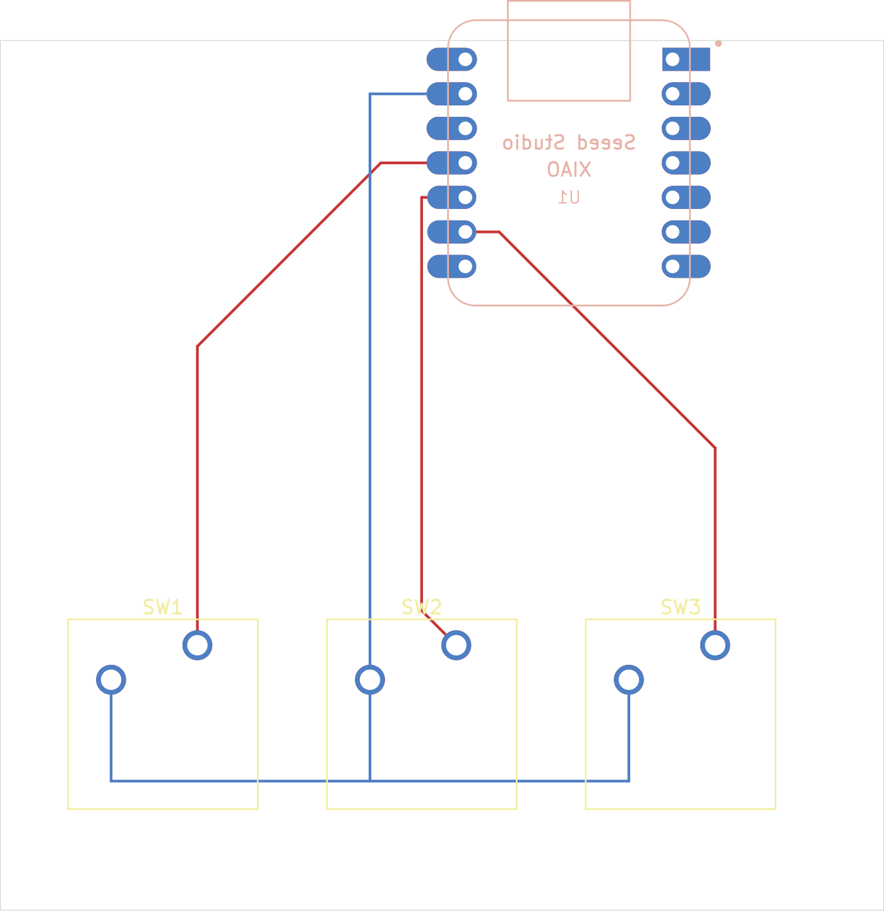
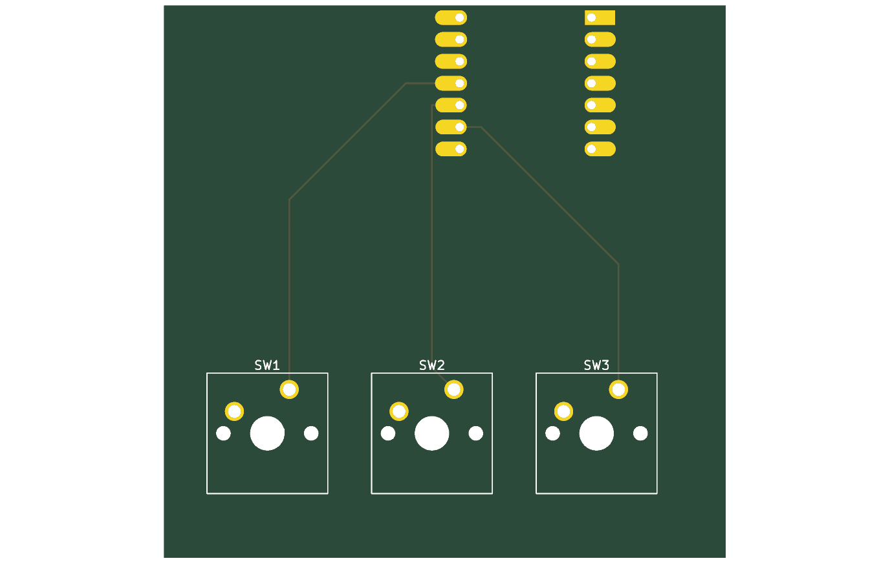

# Hackpad

A 3-key macropad built around a Seeed XIAO RP2040. Each key is wired straight to its own pin, so the board needs no diodes.

## Schematic

## PCB
The XIAO sits on the back of the board at the top edge, so its USB-C port sticks out past the board outline and a cable can be plugged straight in.

## Case
A 3D printed base with a USB-C notch in the back wall, and a switch plate with three 14 mm holes.

## Firmware
KMK firmware in `Firmware/main.py`. SW1, SW2 and SW3 are on pins D10, D9 and D8.

## BOM
Full list with links in [`bom.csv`](bom.csv).

| Item | Qty | Price (USD) | Link |
|---|---|---|---|
| Seeed XIAO RP2040 | 1 | 6.12 | [RobotShop](https://www.robotshop.com/products/seeedstudio-seeed-studio-xiao-rp2040-supports-arduino-micropython-circuitpython) |
| Kailh MX-style switches, 10-pack (3 used) | 1 | 6.95 | [Adafruit](https://www.adafruit.com/product/4996) |
| DSA keycap | 3 | 4.20 (approx.) | [Krome Keycaps](https://www.kromekeycaps.com/products/single-blank-dsa-pbt-keycaps) |
| M3 heat set inserts, 100-pack (4 used) | 1 | 10.99 | [Prusa](https://www.prusa3d.com/en/product/threaded-inserts-m3-standard-100-pcs/) |
| M3x8 screws, 100-pack (4 used) | 1 | 15.85 | [Zoro](https://www.zoro.com/titan-fasteners-m3-x-05-x-8mm-socket-head-cap-screw-304-stainless-steel-pkg-of-100-bsw03008/i/G408426669/) |
| PCB, 5 pcs minimum | 1 | 2.00 | [JLCPCB](https://jlcpcb.com/) |
| 3D printed case (base + plate) | 1 | 6.00 (estimate) | [JLC3DP](https://jlc3dp.com/3d-printing-quote) |
| **Total** | | **52.11** | shipping extra |

## Files
- `CAD/` assembled case model (STEP)
- `PCB/` KiCad schematic and PCB
- `Firmware/` KMK source
- `bom.csv` parts list with prices and links
- `production/` gerbers, case parts and firmware
